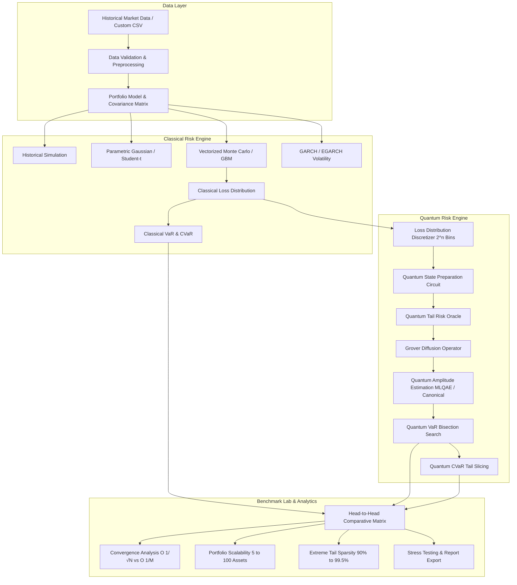

# Quantum Risk Analytics Engine

[](https://www.python.org/downloads/)
[](https://qiskit.org/)
[](https://opensource.org/licenses/MIT)
[](https://streamlit.io/)
[]()

> **Production-grade quantitative finance research platform objectively benchmarking Classical Monte Carlo against Quantum Amplitude Estimation (QAE) for portfolio tail risk (VaR & CVaR).**

---

## 1. Project Overview

The **Quantum Risk Analytics Engine** is a modular, mathematically rigorous research testbed designed for quantitative risk management, financial engineering, and quantum computing experimentation. 

Unlike toy demonstrations that presuppose quantum superiority, this platform implements **objective, reproducible benchmarking** separating **measured empirical runtimes** from **theoretical asymptotic scaling laws**.

The application is structured for:
* MSc Big Data Analytics & Quantitative Finance dissertations
* Quantitative developer and quantum computing technical portfolios
* Reproducible academic experimentation
* Institutional risk analysis demonstration

---

## 2. Core Research Question

> **Can quantum amplitude-estimation techniques provide accurate estimates of portfolio tail risk, particularly Value-at-Risk (VaR) and Conditional Value-at-Risk (CVaR), and how do they compare with classical Monte Carlo methods in terms of accuracy, convergence, and computational requirements?**

This engine objectively evaluates:
1. **Classical Monte Carlo (GBM & Multivariate Normal)**
2. **Parametric Gaussian & Leptokurtic Student-$t$ Models**
3. **Historical Empirical Simulation with Bootstrap Confidence Intervals**
4. **Quantum Amplitude Estimation (Maximum Likelihood QAE & Canonical QPE-based QAE)**
5. **Exact Quantum Statevector Verification**

---

## 3. System Architecture



### Directory Structure

```
quantum-risk-engine/
├── app/
│   ├── app.py                      # Main landing dashboard
│   ├── state.py                    # Session state and global sidebar
│   ├── pages/
│   │   ├── 1_Portfolio.py          # Portfolio construction & allocation
│   │   ├── 2_Risk_Analysis.py      # Historical, parametric, and MC risk
│   │   ├── 3_Classical_Engine.py   # Vectorized Monte Carlo engine
│   │   ├── 4_Quantum_Engine.py     # State prep, oracle, and QAE
│   │   ├── 5_Benchmark_Lab.py      # Head-to-head benchmarking
│   │   ├── 6_Stress_Testing.py     # Macro shocks & GARCH/EGARCH
│   │   └── 7_Research_Report.py    # Automated paper & data export
│   └── components/
│       ├── charts.py               # Dark terminal Plotly figures
│       ├── metrics.py              # Styled KPI cards & status badges
│       ├── tables.py               # Benchmark comparison tables
│       └── explanations.py         # Expandable mathematical callouts
├── src/
│   ├── data/                       # Loaders, cleaners, validators
│   ├── portfolio/                  # Portfolios, returns, covariance
│   ├── classical/                  # MC, historical, parametric VaR/CVaR
│   ├── quantum/                    # State prep, risk oracle, QAE, Q-VaR, Q-CVaR
│   ├── models/                     # Multivariate GBM, GARCH, EGARCH
│   ├── experiments/                # Convergence, scalability, tails
│   └── utils/                      # Config, logging, reproducibility
├── tests/                          # 17 Unit and integration tests
├── data/                           # Bundled sample market datasets
├── results/                        # JSON/CSV experiment audit trail
├── Dockerfile                      # Containerized deployment
├── requirements.txt                # Pinned dependencies
└── README.md
```

---

## 4. Mathematical Methodology

### 4.1 Portfolio Return Vectorization
For $N$ assets with weights $w \in \mathbb{R}^N$ and stochastic return vector $R \in \mathbb{R}^N$:

$$R_p = w^T R = \sum_{i=1}^N w_i R_i \quad \text{subject to} \quad \sum_{i=1}^N w_i = 1$$

Portfolio variance given covariance matrix $\Sigma$:

$$\sigma_p^2 = w^T \Sigma w$$

### 4.2 Value-at-Risk ($\text{VaR}_\alpha$)
At confidence level $\alpha \in (0, 1)$ over horizon $h$, Value-at-Risk represents the $(1-\alpha)$ lower return quantile, or the $\alpha$ upper quantile of portfolio losses $L = -R_p$:

$$\text{VaR}_\alpha = - q_{1-\alpha}(R_p) = \inf \{ l \in \mathbb{R} : P(L > l) \le 1 - \alpha \}$$

### 4.3 Conditional Value-at-Risk ($\text{CVaR}_\alpha$)
CVaR (Expected Shortfall) is a coherent risk measure satisfying sub-additivity:

$$\text{CVaR}_\alpha = \mathbb{E}[L \mid L \ge \text{VaR}_\alpha] = \frac{1}{1 - \alpha} \int_\alpha^1 \text{VaR}_u \, du$$

---

## 5. Classical vs Quantum Risk Algorithms

| Feature | Classical Monte Carlo | Quantum Amplitude Estimation (QAE) |
| :--- | :--- | :--- |
| **Convergence Rate** | $\mathcal{O}\left(\frac{1}{\sqrt{N}}\right)$ (Central Limit Theorem) | $\mathcal{O}\left(\frac{1}{M}\right)$ (Heisenberg Scaling) |
| **Quadratic Advantage** | Baseline | Provable quadratic speedup in query evaluations |
| **Discretization** | Continuous real values | Discretized into $2^n$ basis bins ($n$ qubits) |
| **Measured CPU Runtime** | $< 10\text{ ms}$ (Vectorized AVX2) | $100 - 500\text{ ms}$ (Simulated unitaries on CPU) |
| **Physical Prerequisite** | Standard Von Neumann CPU | Fault-tolerant quantum processor with logical qubits |

### 5.1 Quantum Formulation
1. **Discretization**: Continuous losses $L$ are discretized into $2^n$ bins with probabilities $p_i$.
2. **State Preparation ($\mathcal{A}$)**:
   $$\mathcal{A} |0\rangle^{\otimes n} = \sum_{i=0}^{2^n-1} \sqrt{p_i} |i\rangle$$
3. **Boolean Risk Oracle ($\mathcal{O}$)**: Flips objective ancilla qubit $|0\rangle \to |1\rangle$ if state $i \ge k_{thresh}$:
   $$\mathcal{A}_{risk} |0\rangle^{\otimes (n+1)} = \sqrt{1 - a} |\psi_{safe}\rangle |0\rangle + \sqrt{a} |\psi_{tail}\rangle |1\rangle$$
   where $a = P(L \ge T) = \sin^2(\theta)$.
4. **Grover Diffusion ($Q$)**: Unitary reflection $Q = -\mathcal{A} S_0 \mathcal{A}^\dagger S_\chi$ that rotates by $2\theta$ per iteration.
5. **Estimation**: Maximum Likelihood QAE fits likelihood $L(\theta)$ over powers $m \in \{0, 1, 2, 4\}$ without requiring quantum phase estimation ancillas.

---

## 6. Installation & Quickstart

### Prerequisites
* Python 3.11+
* Git

### Local Setup

```bash
# Clone the repository
git clone https://github.com/your-username/quantum-risk-engine.git
cd quantum-risk-engine

# Create virtual environment
python3 -m venv .venv
source .venv/bin/activate

# Install dependencies
pip install --upgrade pip
pip install -r requirements.txt
```

### Running the Application

```bash
streamlit run app/app.py
```
Open your browser at `http://localhost:8501`.

### Running Tests

```bash
pytest
```

---

## 7. Docker Deployment

Build and run the containerized engine:

```bash
docker build -t quantum-risk-engine .
docker run -p 8501:8501 quantum-risk-engine
```

Access the web interface at `http://localhost:8501`.

---

## 8. Reproducibility & Audit Trail

Every experiment records:
* Deterministic seed
* Asset allocations and returns
* Classical Monte Carlo samples and confidence intervals
* Quantum circuit depth and gate counts
* Qiskit Aer backend and package versions
* Timestamps and platform hardware details

Results are saved to `results/` in structured JSON and CSV formats.

---

## 9. Scientific Limitations

1. **Simulated vs Physical Hardware**: In simulated regimes on classical CPUs, quantum unitary transformations have exponential simulation cost $\mathcal{O}(2^n)$. Classical NumPy matrix operations remain substantially faster in wall-clock time for contemporary hardware.
2. **Discretization Error**: Quantum VaR estimates percentiles over discrete grids ($\Delta L$). Increasing state qubits from 4 to 6 refines accuracy but deepens multi-controlled decomposition circuits.
3. **Quantum CVaR**: CVaR is an expectation of tail events rather than a single event probability; exact quantum evaluation requires piecewise amplitude integration or deep expectation circuits.

---

## 10. Technology Stack

* **Core**: Python 3.12, NumPy, Pandas, SciPy, Scikit-learn
* **Quantum**: Qiskit 2.5+, Qiskit Aer 0.17+
* **Volatility Modeling**: Arch (GARCH/EGARCH)
* **Visualization**: Plotly, HTML5/CSS3
* **Dashboard**: Streamlit
* **Verification**: Pytest

---

## 11. License

MIT License. Designed for quantitative finance academic research and institutional benchmarking.
